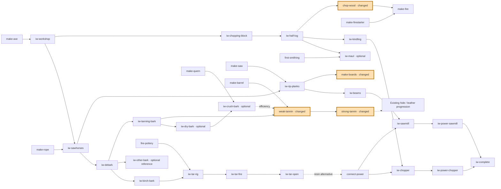

# Immersive Woodworking questbook

## Install and scope

Install `questline_0.15.0.zip`, `questlinevanilla_0.14.0.zip`,
`questlineimmersivewoodworking_0.14.0.zip`, and ImmersiveWoodworking **1.3.13**
(or a compatible later release) on Vintage Story >=1.22.2. The researched pack
runs 1.22.7. This is an independently packaged content addon, not a gameplay-mod
replacement. It adds one 22-quest workshop chapter and three extension files
replacing four existing quests only while `immersivewoodworking` is loaded.

The journey is tuned to the supplied historical **Pszczoly 1.0** settings. Other
servers may differ: in-world sawhorse assembly, half-log axe chopping, ordinary
saws allowed, optional powered machines enabled, and vanilla grid firewood,
plank, debarking and log-tannin routes disabled. The addon does not silently
change server configuration or infer runtime settings. If settings differ,
players/admins should adapt or disable this content pack.

## Authored map

Solid arrows are actual all-of prerequisites (cross-chapter prerequisites are
shown too); dotted arrows are teaching cross-links, not hidden unlock gates.
The four orange nodes are **existing quests changed by extensions**. All other
original quests remain byte-identical, including the existing leather sequence.
The native canvas uses separated fuel, timber, tannery and birch-tar lanes,
color-coded labels and larger hexagonal entry/finish nodes.



### Existing-quest changes

| Quest | Only active with this addon | Detection |
|---|---|---|
| `chop-wood` | Follow workshop axe/half-log introduction, explain disabled grid route | Existing eight-firewood obtain task retained |
| `make-boards` | Follow sawhorse plank tutorial, explain disabled grid route | Existing sixteen-plank obtain task retained |
| `weak-tannin` | Requires barrel and fresh tanning-bark branch; teaches green/dry/crushed barrel recipes | Explicit manual checkbox replaces unreliable bare-liquid possession check |
| `strong-tannin` | Builds on weak tannin and teaches bark strengthening | Explicit manual checkbox replaces unreliable bare-liquid possession check |

Replacement teaching pages use addon-specific `page[].lang` keys, not global
overrides of original quest strings. They keep original IDs and coordinates,
so existing saves do not receive duplicate base quests. Existing completion
flags are not reset or retroactively made unearned. All 26 authored records
explicitly award only one Quest Cookie; the existing reward policy remains in
force. No material resource rewards or hand-in currency loop are added.

### Observation boundaries

Automatic obtain tasks are used only for the chopping block, green/dry tanning
bark, crushed bark, and the two retained vanilla output tasks. They prove
**possession**, not operation, species provenance, elapsed time or machine state.
All interaction, assembly, power, mode switching, tar rig and barrel conversion
steps use honest manual checkboxes. They tell the player to perform the action
and tick it, rather than inventing unsupported task codes/events.

The early axe route is not gated on smithing; the optional maul demonstrates
whole-log-to-firewood in one pass. Debarking is not falsely required for planks
or beams. Green bark can go straight to tannin; drying/grinding are optional,
and grinding explicitly references the existing quern quest. The two powered
lines depend on the existing mechanical-power milestone. Tar is an optional
resin alternative, not a mandatory prerequisite that could create a power loop.

## Source evidence and provenance

[`evidence/immersivewoodworking-1.3.13.json`](evidence/immersivewoodworking-1.3.13.json)
captures the exact original pack and nested-mod SHA256, all nine consumed config
files, selected exact asset text plus hashes, and original native handbook text.
The historical user URL `https://up.snet.ovh/u/srMi9` now returns 404; research
recovered the **original extensionless ZIP**, not the similarly named newer
`Pszczoly_1.0.2`. Historical session `20261114_105735_37d6e7d2`, message 865002,
records downloading that URL as `woodworking-tutorial/modpack`; it contains
Pszczoly 1.0 / game 1.22.7 and `mods/immersivewoodworking_1.3.13.zip`.
Pack SHA256: `daafd4c1cb217b2553711128adfbd71511f5f0734cfb2927a6c4ffea02e0bb2d`.
No third-party gameplay DLL was executed during research.

Primary locators inside that mod:

- `assets/immersivewoodworking/lang/en.json`: `iw-handbook-choppingblock-*`,
  `iw-handbook-sawhorse-*`, `iw-handbook-sawmill-*`, `iw-handbook-chopper-*`,
  maul, half-log, bark, perforated-pot and tar-pot entries. These describe controls,
  component order, removable parts, chute feeding, sawing/stripping locks,
  pot assembly/firing/opening and resin use.
- `assets/immersivewoodworking/itemtypes/bark.json`: actual green/dry bark
  variants; `recipes/barrel/{weaktannin-bark,strongtannin-bark}.json`: green/dry
  bark 1 litre at 72/48 hours; crushed bark 2 litres at 24 hours.
- `assets/immersivewoodworking/config/barkdrops.json`: species-specific bark
  chances; ordinary bark is not tanning bark.
- Exact exported `config/ModConfig/ImmersiveWoodworking/{general,chopping,
  debarking,bark,sawing,automation,drops,flotsam,integration}.json` settings
  select which native handbook branches are active.
- Static decompilation of **the same hashed mod DLL** (`IwSystem.cs`,
  `BEChoppingBlock`, `BESawhorse`, `BESawmillFrame`, `BEChopperFrame`,
  `BEBarkDryPile`, `ItemBark`) confirms runtime recipe registration, manual and
  powered behavior, bark drying and code-added handbook registration.
  `IwSystem.RegisterCraftingInfoWoodworking` / `CraftingInfoBuilder` registers
  the native `handbook://craftinginfo-woodworking` target; it is not a missing
  static handbook JSON file. Decompilation is supporting inspection, not a
  native runtime or shipped copy of proprietary binaries.

## Verification and native caveats

Run the normal build/package, packaging regression, original-content preservation,
translation, real-loader composition, reward-claim and Toolsmith regression gates.
The added Python suite checks scoped replacements, exact fingerprints/config,
merged graph cycles/missing references, localization and honest detection types.
It can replay **every captured evidence asset** against the original private ZIP:

```sh
IW_SOURCE_PACK=/path/to/original/export python3 -m unittest discover -s tests -p test_immersivewoodworking.py -v
```

Without that private archive CI skips just the original-archive replay test; all
checked-in source-contract tests still run. Production C# loader tests exercise
all 60 content contributions, gate the mod off/on, inspect addon teaching pages,
verify cookie-only replacements and shuffle discovery order for determinism.
Original-content byte/hash assertions still cover all 56 upstream files.

Build/loader tests are **not** a native ImmersiveWoodworking gameplay smoke.
VsTestkit is unavailable in this environment. Remaining native checks: open the
workshop and follow every handbook link, inspect canvas text/line layout, run
axe/maul and sawhorse interactions with this pack's settings, all bark stages and
barrel conversions, tar rig firing/reuse, and both complete powered machines.
All locales receive explicit English fallback keys in the existing core-owned
shared translation files; this PR does not claim new translated prose. A
coordinated core update is required alongside the new content ZIP.
